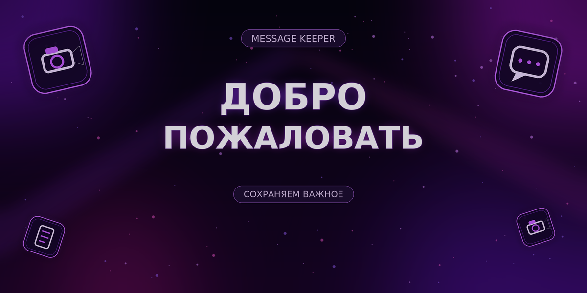

<div align="center">



# Message Keeper

**Telegram Business-бот для архивирования входящих сообщений, отслеживания удалений и правок, а также сохранения доступных медиа.**

<a href="https://www.python.org/"></a>
<a href="https://docs.aiogram.dev/"></a>
<a href="https://core.telegram.org/bots/api"></a>


[Возможности](#-возможности) · [Быстрый запуск](#-быстрый-запуск) · [Подключение](#-подключение-к-telegram) · [Настройки](#%EF%B8%8F-настройки) · [Команды](#-команды) · [FAQ](#-ограничения-и-диагностика)

</div>

---

> [!IMPORTANT]
> Бот использует **официальный Telegram Business API**. Это не userbot: номер телефона, пароль и код входа не требуются. Для запуска нужен только токен от [@BotFather](https://t.me/BotFather).
>
> Архивируются только **новые сообщения**, полученные после подключения, и только из разрешённых владельцем аккаунта чатов. Старые удалённые сообщения и секретные чаты недоступны.

## ✨ Возможности

| Функция | Что делает |
|---|---|
| 🗑 **Удалённые сообщения** | Присылает сохранённую копию, отправителя, чат и время удаления. |
| ✏️ **История правок** | Показывает текст или подпись **до и после** редактирования. |
| 📎 **Архив медиа** | Сохраняет доступные фото, видео, GIF, голосовые, кружочки, аудио, документы и стикеры. |
| 🔥 **Медиа по ответу** | Пытается сохранить файл после ответа `save` или `/save` в исходном диалоге. |
| 👥 **Разделение владельцев** | Изолирует данные разных Business-подключений. |
| 📊 **Статистика** | Показывает состояние подключения и количество записей в архиве. |
| 🧹 **Контроль данных** | Автоочистка по сроку хранения и полное удаление своих данных по команде. |
| 🐳 **Удобный запуск** | Python, long polling и Docker Compose; отдельный сервер БД не нужен. |

## 🚀 Быстрый запуск

### 1. Создайте бота

1. Откройте [@BotFather](https://t.me/BotFather) и отправьте `/newbot`.
2. Задайте имя и уникальный username, затем скопируйте токен.
3. Откройте `/mybots` → ваш бот → **Bot Settings** → **Business Mode** или **Secretary Mode** и включите режим. Название зависит от версии BotFather.

> [!CAUTION]
> Токен — это пароль от бота. Не публикуйте его, не отправляйте другим людям и не загружайте `.env` на GitHub. Если токен уже попал в репозиторий, перевыпустите его через BotFather.

### 2. Скачайте проект и создайте конфигурацию

```bash
git clone https://github.com/daniil629/saveMOD.git
cd saveMOD
cp .env.example .env
```

Откройте `.env` в текстовом редакторе и замените значение `BOT_TOKEN` на настоящий токен:

```dotenv
BOT_TOKEN=123456789:ВАШ_НОВЫЙ_ТОКЕН
```

В Windows вместо `cp` можно скопировать файл `.env.example` через Проводник и переименовать копию в `.env`.

### 3А. Запуск через Docker Compose

```bash
docker compose up -d --build
docker compose logs -f bot
```

Остановка без удаления базы и медиа:

```bash
docker compose down
```

SQLite и файлы сохраняются в Docker volume `bot_data`. Не добавляйте флаг `-v`, если хотите сохранить данные.

### 3Б. Запуск через Python

Требуется **Python 3.10+**.

**Windows:**

```powershell
py -m venv .venv
.venv\Scripts\Activate.ps1
pip install -r requirements.txt
python -m app.main
```

**Linux / macOS:**

```bash
python3 -m venv .venv
source .venv/bin/activate
pip install -r requirements.txt
python -m app.main
```

Запускайте команды из **корня проекта**, где находится `README.md`, а не из папки `app`.

Long polling используется по умолчанию: публичный домен, HTTPS и открытый порт не нужны. Для работы 24/7 оставьте процесс запущенным на сервере.

## 🤖 Подключение к Telegram

1. Откройте диалог со своим ботом и нажмите **Start** или отправьте `/start`.
2. В Telegram откройте **Настройки → Автоматизация чатов**. В старых версиях: **Telegram для бизнеса → Чат-боты**.
3. Добавьте username бота.
4. Выберите только те личные чаты, которые вы вправе архивировать.
5. Дождитесь сообщения «Архивирование подключено».
6. Для проверки отправьте сообщение с другого аккаунта, затем измените и удалите его. Отчёты должны появиться в личном чате с ботом.

Подключение Business-бота не требует Telegram Premium согласно [официальной документации](https://core.telegram.org/api/bots/connected-business-bots).

## 💾 Сохранение медиа по ответу

Обычные доступные медиа кэшируются автоматически. Для ручной попытки сохранения:

1. **Не открывайте** исчезающее фото или видео.
2. Ответьте на него в исходном личном диалоге словом `save` или `/save`.
3. Если Telegram ещё предоставляет файл через Bot API, бот пришлёт копию в ваш чат с ботом.

Это не обход ограничений Telegram: если файл недоступен через API, сохранить его невозможно.

## 📋 Команды

| Команда | Назначение |
|---|---|
| `/start` | Приветствие, возможности и кнопка инструкции. |
| `/help` | Инструкция по подключению и сохранению медиа внутри бота. |
| `/status` | Подключения, количество сообщений, правок, удалений и файлов. |
| `/privacy` | Информация о хранении и текущем сроке автоочистки. |
| `/delete_my_data` | После подтверждения удалить историю, медиа и записи подключений владельца. |

`/delete_my_data` не отключает Business-подключение. Чтобы прекратить сбор новых сообщений, дополнительно отключите бота в **Автоматизации чатов**.

## ⚙️ Настройки

Все параметры задаются в локальном файле `.env`. Пример без секретов находится в [`.env.example`](.env.example).

| Переменная | По умолчанию | Описание |
|---|---:|---|
| `BOT_TOKEN` | — | Секретный токен от BotFather. |
| `DATA_DIR` | `./data` | Каталог SQLite и медиа. |
| `SAVE_MEDIA` | `true` | Скачивать доступные медиа. |
| `MAX_MEDIA_SIZE_MB` | `20` | Локальный лимит размера одного файла. |
| `RETENTION_DAYS` | `7` | Срок хранения; `0` отключает автоочистку. |
| `CLEANUP_INTERVAL_HOURS` | `12` | Период запуска автоочистки. |
| `LOG_DELETIONS` | `true` | Присылать отчёты об удалениях. |
| `LOG_EDITS` | `true` | Присылать отчёты о правках. |
| `SAVE_MEDIA_ON_REPLY` | `true` | Разрешить сохранение по ответу. |
| `LOG_LEVEL` | `INFO` | Уровень журналирования. |

## 🗂 Структура проекта

```text
message-keeper-bot/
├── app/
│   ├── assets/welcome.png    # Обложка приветствия
│   ├── handlers/
│   │   ├── business.py       # Business-сообщения, правки и удаления
│   │   └── commands.py       # /start, помощь, статистика и приватность
│   ├── config.py             # Настройки из .env
│   ├── db.py                 # SQLite и миграции
│   ├── main.py               # Точка входа и long polling
│   ├── media.py              # Сохранение и удаление медиа
│   └── utils.py              # Безопасное HTML-оформление отчётов
├── tests/                    # Автономные тесты без Telegram API
├── scripts/                  # Генератор обложки
├── .env.example              # Пример конфигурации без секретов
├── docker-compose.yml        # Запуск с постоянным хранилищем
├── requirements.txt          # Зависимости приложения
└── README.md                 # Документация
```

## 🔐 Приватность и безопасность

- Содержимое сообщений не выводится в обычные логи.
- `.env`, `data/`, `.venv/` и другие локальные файлы исключены через `.gitignore`.
- Медиа сохраняются под хэшем connection ID, а не под его открытым значением.
- Удаление файлов ограничено каталогом медиа.
- Шифрование данных на диске **не встроено**. На сервере используйте шифрование диска, резервные копии и ограниченный доступ.
- Оператор бота отвечает за политику приватности, сроки хранения и обработку запросов на удаление. Используйте архивирование законно и, когда требуется, информируйте собеседников.

См. также [Telegram Bot Developer Terms](https://core.telegram.org/bots/terms).

## ❗ Ограничения и диагностика

<details>
<summary><b>Что бот не может сделать</b></summary>

- Восстановить сообщения, удалённые **до подключения**.
- Прочитать произвольные чаты, группы, каналы или чужой аккаунт без разрешения.
- Работать в секретных чатах.
- Гарантированно сохранить исчезающее медиа, если Telegram не отдаёт файл через Bot API.
- Обойти серверные ограничения на размер скачиваемых файлов.

Описание Business-событий: [Telegram Bot API](https://core.telegram.org/bots/api).

</details>

<details>
<summary><b>Telegram пишет, что бот не поддерживает Business</b></summary>

Включите **Business / Secretary Mode** в BotFather и перезапустите Telegram. При запуске бот также предупреждает, если `getMe` не возвращает `can_connect_to_business=true`.

</details>

<details>
<summary><b>Нет отчётов об удалениях</b></summary>

Проверьте, что процесс работает, нужный чат выбран в настройках подключения, а исходное сообщение было получено после подключения. Бот не может показать содержимое сообщения, которого нет в архиве.

</details>

<details>
<summary><b>Ошибки 401 и 409</b></summary>

- **401 Unauthorized:** токен неверный или отозван. Выпустите новый токен и обновите `.env`.
- **409 Conflict:** обычно запущен второй экземпляр с тем же токеном или настроен webhook. Оставьте только один polling-процесс.

</details>

## 🧪 Разработка и тесты

```bash
python3 -m venv .venv
source .venv/bin/activate
pip install -r requirements-dev.txt
python -m compileall app tests
ruff check app tests
pytest
```

Тесты используют временную SQLite и поддельный загрузчик медиа. Реальный токен, сеть и Telegram-аккаунт не нужны.

История изменений: [v1.1](UPDATE_v1.1.md) · [v1.2](UPDATE_v1.2.md).

---

<div align="center">

**Message Keeper · v1.2.0**  
Поддержка: [@ovexiu](https://t.me/ovexiu)

</div>
